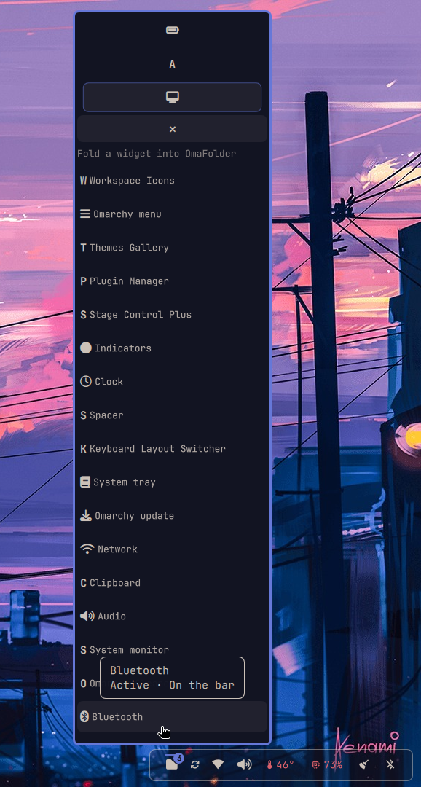

# OmaFolder

[English](README.md)

**یک پوشه روی بار Omarchy که ویجت‌هایی را که کم لازم دارید در خود نگه می‌دارد.**
ویجت را داخل پوشه بگذارید تا از بار حذف شود؛ با باز کردن پوشه، درِ کشویی عمودی
محتوای آن را می‌بینید و هر وقت لازمش داشتید از همان‌جا بازش می‌کنید یا با کلیک
راست به بار برمی‌گردانید.

برای **Omarchy 4 (Quattro)** ساخته شده: یک `bar-widget` بومی Quickshell، بدون
Waybar و بدون پروسهٔ اضافه روی دسکتاپ.



## امکانات

| تعامل | نتیجه |
|---|---|
| کلیک چپ روی پوشه | باز/بسته کردن درِ کشویی (از پایین به بالا باز می‌شود) |
| کلیک چپ روی ردیف تاشده | اجرای کار اصلی همان ویجت: پنل خودش باز می‌شود. ویجتی که فقط روی بار زندگی می‌کند (پلاگین پنل نیست) اول به بار برگردانده و همان‌جا باز می‌شود |
| کلیک چپ روی دکمهٔ **＋** | ۴۵ درجه می‌چرخد و **×** می‌شود، در عریض می‌شود و همهٔ ویجت‌های روی بار که هنوز تا نشده‌اند فهرست می‌شوند |
| کلیک چپ روی ردیف‌های زیر **×** | همان ویجت را داخل پوشه می‌تازد؛ در باز می‌ماند |
| **کلیک راست روی ردیف تاشده** | منوی کارها: باز کردن پنل، فعال/غیرفعال، یک ردیف بالا، یک ردیف پایین، بررسی به‌روزرسانی، بیرون‌انداختن به بار |
| نگه داشتن موس روی ردیف ۱.۵ ثانیه | تولتیپ با نام، وضعیت و نوع ویجت |
| `j`/`k`، Enter، `x`، `m`، `c`، Escape | کیبورد: حرکت، باز کردن، بیرون‌انداختن، نمای **＋**، بررسی به‌روزرسانی، بستن |

وقتی **×** باز است، کل در به عرض یک فهرست بزرگ می‌شود و هر ردیف — چه تاشده‌های
بالای **×** و چه ویجت‌های موجود زیر آن — آیکن را سمت چپ و نام کامل را کنارش
نشان می‌دهد، با همان ستون و همان حاشیهٔ یکسان. با کلیک دوباره روی **×** همه‌چیز
به نوار باریک ۳۲ پیکسلی برمی‌گردد.

در حالت بسته نوار فقط ۳۲ پیکسل عرض دارد؛ آیکن از هر طرف حدود یک پیکسل فاصله
دارد. هر تغییری که به ویجت مربوط است (فعال/غیرفعال، جابه‌جایی، بیرون‌انداختن) در
منوی کلیک راست است، بنابراین یک کلیک اشتباه هیچ‌چیز را جابه‌جا نمی‌کند.

ویجت غیرفعال در درِ کشویی کم‌رنگ می‌شود و پنلش بسته می‌شود. چون ویجت تاشده از
قبل از بار حذف شده، خروجی پس‌زمینه‌ای نمانده که معلق شود؛ ضمناً QML معادل
`filter: grayscale()` ندارد، پس «غیرفعال» با کم‌رنگ‌کردن نمایش داده می‌شود.

## نصب

```sh
omarchy plugin add https://github.com/shayanshahravi/OmaFolder.git --enable
```

یا از داخل مخزن:

```sh
./install.sh           # کلون و فعال‌سازی
./install.sh --local   # نصب همین نسخهٔ کاری (برای توسعه)
```

`install.sh` از `~/.config/omarchy/shell.json` بکاپ می‌گیرد،
`~/.config/omafolder/state.json` را می‌سازد، پلاگین را فعال می‌کند و اگر پوشه روی
بار نباشد آن را در سمت چپ قرار می‌دهد. اجرای دوباره، نسخهٔ نصب‌شده را به‌روز
می‌کند و خطا نمی‌دهد.

پیش‌نیاز: Omarchy 4 و `python3` (فقط کتابخانهٔ استاندارد). نه نصب‌کننده و نه
پلاگین هیچ‌جا دسترسی بالا نمی‌خواهد و هیچ شل دومّی اجرا نمی‌کند.

## استفاده

1. روی آیکن پوشه کلیک کنید تا در باز شود.
2. دکمهٔ **＋** را بزنید تا در عریض شود و ویجت‌های روی بار فهرست شوند.
3. روی یکی کلیک کنید تا داخل پوشه بیاید.
4. برای باز کردن پنل یک ردیف تاشده رویش کلیک چپ کنید، و برای برگرداندنش به بار
   کلیک راست و «Eject to bar» را بزنید.

## چطور کار می‌کند

OmaFolder یک فایل وضعیت JSON دارد و چیدمان بار را خودش ویرایش می‌کند:

```
~/.config/omafolder/state.json          ویجت‌های تاشده و ترتیبشان
~/.config/omarchy/shell.json            ورودی‌های bar.layout.<section>
~/.local/state/omafolder/backups/       بکاپ shell.json در هر تغییر
```

تاشدن، ورودی ویجت را از `bar.layout` حذف می‌کند و بخش و ایندکس آن را نگه
می‌دارد؛ بیرون‌انداختن، آن را دقیقاً همان‌جا برمی‌گرداند. همهٔ کارها از طریق
`bin/omafolder-state` انجام می‌شود که برای هر فرمان یک شیء JSON چاپ می‌کند و پس
از هر نوشتن، شل را دوباره بار می‌کند. جای دیگری از `shell.json` تغییر نمی‌کند.

```sh
bin/omafolder-state summary        # آیتم‌ها + اطلاعات ویجت‌ها
bin/omafolder-state bar-modules    # ویجت‌های باقی‌مانده روی بار
bin/omafolder-state fold <id>
bin/omafolder-state eject <id>
bin/omafolder-state toggle <id>
bin/omafolder-state reorder <id> <index>
bin/omafolder-state update-check <id>
bin/omafolder-state update <id>
bin/omafolder-state eject-all      # استفاده‌شده در uninstall.sh
```

تم دستی پارس نمی‌شود: رنگ‌ها، شعاع گوشه، فونت و فاصله‌ها از سینگلتون‌های
`Color` و `Style` خود شل می‌آیند، پس درِ کشویی با هر تمی هم‌رنگ می‌شود.

IPC شل (برای اسکریپت و شورتکات):

```sh
omarchy-shell shell toggle io.github.shayanshahravi.omafolder '{}'
omarchy-shell shell call io.github.shayanshahravi.omafolder refresh
```

هدف IPC فقط یک بار — توسط ویجت اولین نمایشگر — ثبت می‌شود و هر فرمان به نمونه‌های
بقیهٔ نمایشگرها هم منتقل می‌شود، پس در چیدمان چند-مانیتوری رفتار یکسان است.

## جابه‌جایی یا حذف

```sh
omarchy bar move io.github.shayanshahravi.omafolder --section right --index 0
```

```sh
./uninstall.sh            # ویجت‌ها را به بار برمی‌گرداند و پلاگین را حذف می‌کند
./uninstall.sh --purge    # پوشهٔ ~/.config/omafolder را هم پاک می‌کند
```

## نکته‌ها

- فقط ویجت‌هایی که همین حالا روی بار هستند قابل تاشدن‌اند؛ نمای **＋** دقیقاً
  همان‌ها را نشان می‌دهد.
- ویجت تاشده نمونهٔ زنده‌ای روی بار ندارد و شل پنلش را فقط از طریق همان نمونه
  باز می‌کند؛ برای همین کلیک چپ اول آن را به بار برمی‌گرداند و بعد بازش می‌کند.
- `omarchy.tray` توسط بار داخلی پین می‌شود؛ تاشدنش کار می‌کند ولی Omarchy ممکن
  است در بازسازی بعدی بار دوباره پینش کند.
- «Check for update» نسخهٔ منتشرشده را از مارکت رسمی Omarchy می‌پرسد و فقط بعد
  از تأیید خودتان در همان درِ کشویی نصب می‌کند.

## توسعه

```sh
omarchy plugin validate .
/usr/lib/qt6/bin/qmllint -I "$OMARCHY_PATH/shell" BarWidget.qml Drawer.qml DrawerItem.qml
python3 -m py_compile bin/omafolder-state

./tests/run.sh          # منطق مدل، سینتکس QML، موتور وضعیت
```

راهنما: [CONTRIBUTING.md](CONTRIBUTING.md)

## مجوز

MIT © Shayan Shahravi
