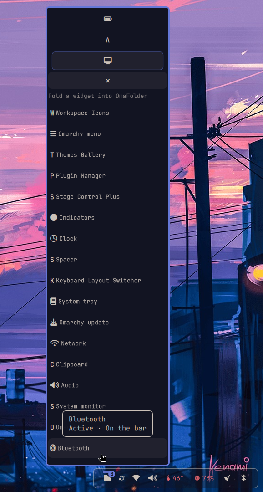

# OmaFolder

[فارسی (Persian)](README.fa.md)

**A folder on the Omarchy bar that holds the widgets you rarely need.** Fold a
bar widget into it and it leaves the bar; open the folder to get a vertical
drawer of what is inside, and pull anything back out with a three-second hold or
a drag.

Built for **Omarchy 4 (Quattro)**: a native Quickshell `bar-widget`, no Waybar
and no extra desktop process.



## Features

| Interaction | What happens |
|---|---|
| Left click on the folder | Opens or closes the vertical drawer (it slides up from the bar) |
| Left click on an icon | Opens that widget's own panel |
| **Right click on an icon** | Action menu: open panel, activate/deactivate, move up, move down, eject to bar |
| **Drag an icon inside the drawer** | Reorders it |
| **Drag an icon out of the drawer** | Ejects it back onto the bar at the position it came from |
| **Drag (or click) in the ＋ view** | Folds a widget from the bar into the folder |
| `j` / `k`, Enter, `x`, `m`, Escape | Keyboard: move, open, eject, manage view, close |

The drawer is a 32 px strip: the icon keeps about a pixel of space on each
side. Everything that changes a widget — activate, deactivate, reorder, eject —
lives in the right-click menu, so a stray click on an icon never changes anything.

A deactivated widget is dimmed in the drawer and its panel is closed. Because a
folded widget has already left the bar, there is no background output left to
suspend — QML has no CSS `filter: grayscale()`, so "deactivated" is expressed by
dimming rather than a grayscale filter.

## Install

```sh
omarchy plugin add https://github.com/shayanshahravi/OmaFolder.git --enable
```

or from a checkout:

```sh
./install.sh           # clone and enable
./install.sh --local   # install this working tree instead (for development)
```

`install.sh` backs up `~/.config/omarchy/shell.json`, creates
`~/.config/omafolder/state.json`, enables the plugin and places the folder on the
left of the bar when it is not there yet. Running it again updates the existing
checkout instead of failing.

Requirements: Omarchy 4 and `python3` (standard library only). Neither the
installer nor the plugin asks for elevated privileges, and it never starts a
second shell process.

## Usage

1. Click the folder icon to open the drawer.
2. Press **＋** at the bottom to list the widgets still on your bar.
3. Click one to fold it in, or drag it onto the folder.
4. Hold an icon for three seconds (or drag it out) to put it back on the bar.

## How it works

OmaFolder keeps one JSON state file and edits the bar layout for you:

```
~/.config/omafolder/state.json          which widgets are folded, in order
~/.config/omarchy/shell.json            bar.layout.<section> entries
~/.local/state/omafolder/backups/       shell.json backups from every change
```

Folding a widget removes its entry from `bar.layout`, remembering the section
and index; ejecting restores it exactly there. Everything goes through
`bin/omafolder-state`, which prints one JSON object per command and reloads the
shell after a write. Nothing else in `shell.json` is touched.

```sh
bin/omafolder-state summary        # items + metadata
bin/omafolder-state bar-modules    # widgets still on the bar
bin/omafolder-state fold <id>
bin/omafolder-state eject <id>
bin/omafolder-state toggle <id>
bin/omafolder-state reorder <id> <index>
bin/omafolder-state eject-all      # used by uninstall.sh
```

Themes are not parsed by hand: colours, radius, fonts and spacing come from the
shell's own `Color` and `Style` singletons, so the drawer follows whatever theme
is active.

Shell IPC (for scripts and shortcuts):

```sh
omarchy-shell shell toggle io.github.shayanshahravi.omafolder '{}'
omarchy-shell shell call io.github.shayanshahravi.omafolder refresh
```

## Move or remove

```sh
omarchy bar move io.github.shayanshahravi.omafolder --section right --index 0
```

```sh
./uninstall.sh            # returns folded widgets to the bar, removes the plugin
./uninstall.sh --purge    # also deletes ~/.config/omafolder
```

## Notes

- Only widgets that are currently on the bar can be folded; the manage view
  lists exactly those.
- `omarchy.tray` is pinned by the built-in bar. Folding it works, but Omarchy may
  pin it back on the next bar rebuild.
- Widgets with a panel open it with `omarchy-shell shell toggle <id>`; widgets
  without one show a short notice instead.

## Development

```sh
omarchy plugin validate .
/usr/lib/qt6/bin/qmllint -I "$OMARCHY_PATH/shell" BarWidget.qml Drawer.qml DrawerItem.qml
python3 -m py_compile bin/omafolder-state

./tests/run.sh          # model logic, QML syntax, state engine
./tests/run.sh --live   # + drag and drop inside the running shell
```

The live suite drives the drawer's real drag path (begin, move, hit test, drop
rule, state write) from inside `omarchy-shell`, then reinstalls the clean copy.
It restarts the shell twice, so run it deliberately.

See [CONTRIBUTING.md](CONTRIBUTING.md).

## License

MIT © Shayan Shahravi
